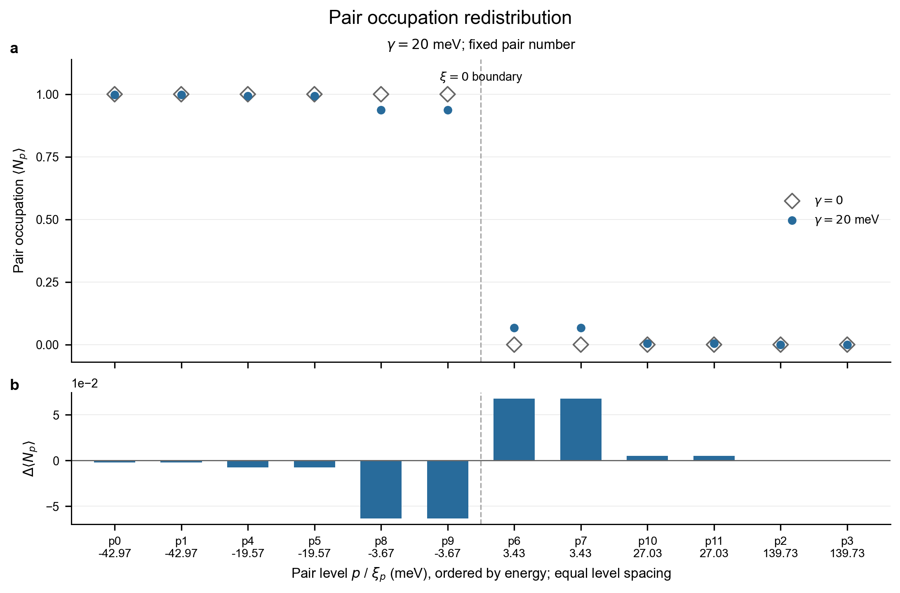
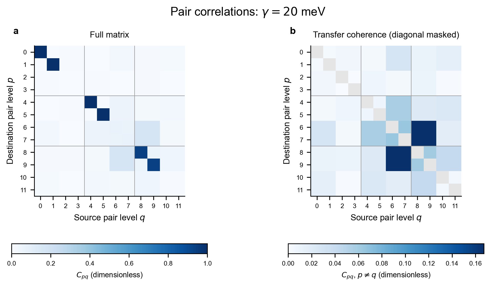

# NbO 有限配对模型 · v1

使用 NbO 第一性原理能带能量，构造守恒电子对数的约化配对哈密顿量，计算基态与配对关联，并导出量子比特 Pauli 项。

**单粒子能量来自 DFT；配对作用为参数化假设。** 当前是量子算法与建模原型，尚未完成材料相互作用下折叠，不能单独证明 NbO 的体相超导。本版只研究基态。

## 快速开始

建议 Python 3.12（参考结果使用 3.12、NumPy 2.3.5、SciPy 1.16.3）。进入本文件所在目录，创建环境：

```bash
python -m venv .venv
```

激活环境，Windows PowerShell：

```powershell
.\.venv\Scripts\Activate.ps1
```

Linux/macOS：

```bash
source .venv/bin/activate
```

安装依赖并计算：

```bash
python -m pip install -r requirements.txt
python build_pairing_model.py
python plot_results.py
```

不需要 VASP、节点连接或原始波函数。运行后查看 `results/RESULTS.md`；输出目录由 `.gitignore` 忽略，重复运行会更新该目录。修改 `model_config.json` 可调整作用强度，单位为 eV。

`plot_results.py` 读取计算输出，在 `figures/` 生成两张有物理含义的图：零作用与参考作用下的电子对占据数对比，以及配对关联矩阵热图。每张图同时导出 PNG、SVG、PDF，并附绘图 CSV、检查记录和中文解释。绘图不会改变模型参数，也不会重新求解。`figures/` 可随项目提交 GitHub，重复运行绘图会更新其中的生成文件。





图的逐项解释见 [figures/README.md](figures/README.md)。分数占据是完整电子对占据的平均值；非对角关联是转移相干性，不能直接解释为转移概率或体相超导证据。

## 模型

$$
H=2\sum_p\xi_pN_p-\sum_{pq}G_{pq}b_p^\dagger b_q,
\qquad G_{pq}=\frac{\gamma}{M}.
$$

- 每条候选带选取最接近费米能的一个负能态、一个正能态，并补齐两个时间反演配对方向。
- 共 12 个配对能级；只允许空态和双占据，每级可编码为一个量子比特。
- 按选中能级的零作用填充固定 6 对电子，矩阵维度为 924。这不是将体相电子数严格下折叠所得。
- 默认作用强度为 20 meV；同时扫描 0、10、50、100 meV。
- 不可约 k 点权重仅作数据来源记录，不用于把选中轨道解释为全布里渊区积分。

详细的配对定义、量子比特公式和局限见 [MODEL.md](MODEL.md)。

## 文件布局

```text
04_pairing_model/
├── README.md                   # 安装和运行入口
├── MODEL.md                    # 模型定义、近似和输出解释
├── requirements.txt            # 参考计算使用的依赖版本
├── model_config.json           # 模型参数
├── build_pairing_model.py      # 构造、求基态和 Pauli 映射核对
├── plot_results.py             # 读取结果，绘制占据数与配对关联
├── extract_scf.py              # 可选：从自有原始输出重新提取
├── data/
│   ├── README.md               # 输入字段和来源
│   ├── candidate_bands_25_27.csv
│   ├── band_summary.csv
│   └── metadata.json
├── reference_results/          # 默认参数的轻量参考结果
├── figures/                    # 图、绘图数据和解释，可提交 GitHub
└── results/                    # 运行时生成，不提交到 Git
```

## 默认参考结果

| 量 | 数值 |
| --- | --- |
| 配对能级 / 固定电子对数 | 12 / 6 |
| 固定粒子数矩阵维度 | 924 |
| 作用强度 gamma | 0.020 eV |
| 每个作用矩阵元 G_pq | 0.0016666667 eV |
| 基态能量 | 约 −0.2772959833 eV |
| 相对同一 H 下未关联填充态的关联能 | 约 −2.453103 meV |

能量以 DFT 费米能为参考，仅属于有限活性空间；不是 VASP 总能量或材料凝聚能。末位数值会随数值库和平台略有差异。

程序自动检查零作用极限、厄米性、基态残差、配对关联矩阵及量子比特映射。参考扫描见 [reference_results/RESULTS.md](reference_results/RESULTS.md)。

本目录可以作为独立 GitHub 仓库根目录上传；无需上传外部原始计算备份。
