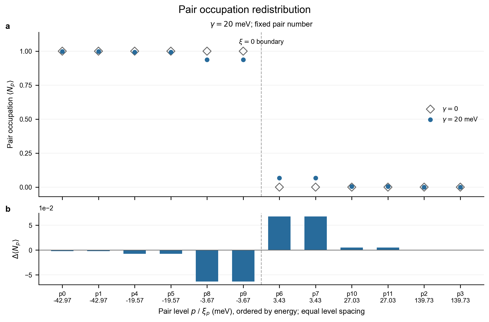
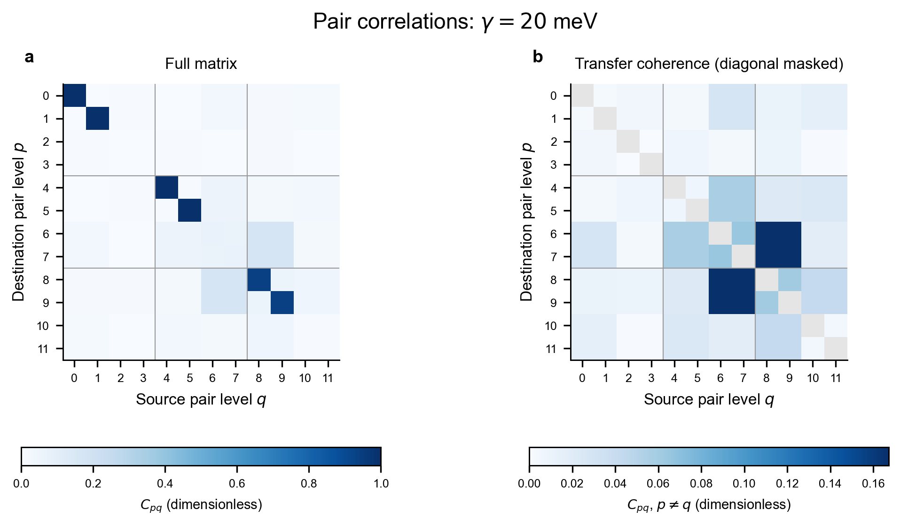

# 有限配对模型：两张图的读取方法

两张图由 `plot_results.py` 读取现有计算输出生成。PNG 供查看，SVG/PDF 供放大或编辑；CSV 是实际绘图数据。图中使用英文标签以便跨平台复现。

默认参考参数：gamma = 20 meV；每个 G_pq = 1.666667 meV；固定 6 对电子。

## 1. 占据数对比



- a：空心菱形为 gamma=0 的填充态，蓝点为参考作用强度下的基态。纵轴是电子对占据数 `<N_p>`，取值在 0 到 1；平均电子数是其两倍。
- 横轴逐个展示按 xi 排序的配对能级；每个标签上行为原始编号 p，下行为 xi（meV）。横向间距只是等距排列，不是实际能量间隔。虚线分开负能级和正能级。
- 两个配对方向即使能量相同也保留为两个点，未平均或合并。编号、能带及方向对应 `occupation_comparison.csv` 和计算输出的 `active_levels.csv`。
- b：`Delta<N_p> = <N_p>_reference - <N_p>_gamma=0`。负能级失去部分占据，正能级获得部分占据；总变化为零。
- 正能级的总电子对占据为 **0.145839**；总占据仍为 **6.000000**。分数占据来自多体叠加，不代表恢复了单电子占据态。
- 零作用基线是同一有限模型的精确填充态，不是 VASP 展宽后的单粒子占据数。

## 2. 配对关联矩阵



- 定义：`C_pq = <Psi_0 | b_p^dagger b_q | Psi_0>`，无量纲。行 p 是电子对到达的能级，列 q 是电子对移出的能级。
- a：完整矩阵，`C_pp = <N_p>`；色标范围固定为 0 到 1。
- b：同一矩阵的非对角部分，灰色对角线被遮罩，并非数值为零。采用独立的线性色标，显式展示较小的转移相干性；不能直接跨面板比较颜色深浅。
- p 按原始编号排列，细线划分来自不同候选能带的能级块。
- 零作用填充态的所有非对角元为零；参考作用下最大非对角元绝对值为 **0.167171**。逐项对比见 `correlation_comparison.csv`。
- 非对角元是相干期望值，不是转移概率或转移速率，也不是具有空间距离坐标的长程关联。固定粒子数下 `<b_p>` 为零，不妨碍 `<b_p^dagger b_q>` 非零。

## 复现与检查

在项目目录执行：

```bash
python build_pairing_model.py
python plot_results.py
```

这是确定性的有限模型基态计算，没有随机抽样，不画统计误差条。数值检查包括占据范围、总电子对数、关联矩阵对称性与半正定性，以及占据数与矩阵对角元的一致性；检查和输入哈希记录在 `plot_record.json`。

这些图说明参数化吸引作用下，当前受限配对空间中的占据重分配和能级间关联；不能单独证明 NbO 体相超导。DFT 提供 xi，配对作用仍为人为设置。
